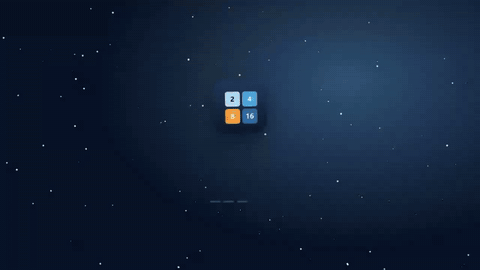

<!-- ENS:TANITIM -->
## 🎬 Tanıtım

Tam kalitede izlemek için görsele tıkla · MP4, 26 saniye

<!-- /ENS:TANITIM -->

2048 tarzı kış bulmacası. Aynı iki karoyu birleştir, bir üst aşamaya geç: kar tanesinden kartopuna, kardan adama, fenere… ve sonunda **Ayaz Ata**'ya.

**[→ Hemen oyna](https://enskygr234.github.io/kar-birlestir/)**

## Aşamalar

❄️ Kar tanesi (2) → ⚪ Kartopu (4) → 🧊 Buz (8) → 🔹 Sarkıt (16) → ⛄ Kardan adam (32) → 🛷 Kızak (64) → 🏮 Fener (128) → 🔥 Ocak (256) → 🐻‍❄️ Kutup ayısı (512) → 🌌 Kuzey ışığı (1024) → 🧙 **Ayaz Ata (2048)**

Ayaz Ata'yı çağırdıktan sonra devam edersen sürpriz bir aşama daha var.

## Nasıl oynanır

- Telefonda **kaydır**, bilgisayarda **ok tuşları** (ya da W A S D).
- Her hamlede bütün karolar o yöne kayar; aynı iki karo çarpışınca birleşir.
- **↶ Geri** son hamleyi geri alır (Ctrl + Z da olur).
- Oyun kendiliğinden kaydedilir; sekmeyi kapatsan da kaldığın yerden devam edersin.

## Telefona kur

- **Ana ekrana ekle (şimdi):** Telefonda Chrome ile [https://enskygr234.github.io/kar-birlestir/](https://enskygr234.github.io/kar-birlestir/) adresini aç → sağ üstteki **⋮** → **Ana ekrana ekle**. Oyun uygulama gibi tam ekran açılır ve internetsiz de çalışır.
- **APK:** [Buradan indir](https://github.com/Enskygr234/kar-birlestir/releases/download/son-surum/KarBirlestir.apk), dosyayı aç ve kur. Telefon ilk seferde "bilinmeyen kaynaklardan yükleme" izni isteyebilir. Her güncellemede GitHub Actions yeni APK'yı kendiliğinden derler.

## Lisans

[MIT](LICENSE) © Winterdeveloper

<!-- ENS:ALT -->
---

**❄️ ENS Developer'ın diğer projeleri**

🎮 Oyunlar: [Mahalle](https://github.com/Enskygr234/mahalle) · [Ayaz Ata'nın Feneri](https://github.com/Enskygr234/ensdewloper.github.io/tree/main/ayaz-feneri) · [Kayıp Fener](https://github.com/Enskygr234/kayip-fener) · [Son Kış](https://github.com/Enskygr234/son-kis) · [Ayazle](https://github.com/Enskygr234/ayazle) · [Buz Kırıcı](https://github.com/Enskygr234/buz-kirici)

[🌐 Bütün projeler](https://enskygr234.github.io/ensdewloper.github.io/) · [👤 GitHub profilim](https://github.com/Enskygr234)

Kış gelir, kod yazılır.

<!-- /ENS:ALT -->
